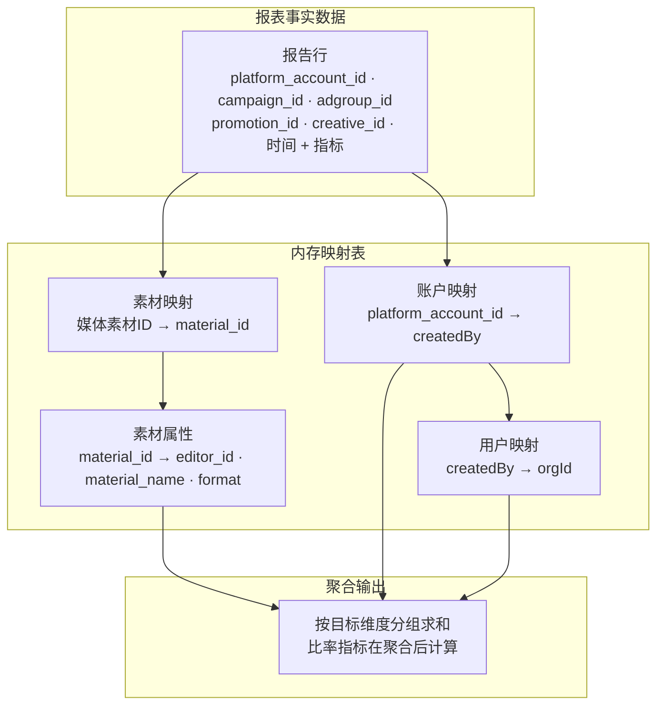

# 素材报表维度与筛选扩展设计

## 一、设计概述

### 目的与范围

本文说明素材报表取数接口为支撑「资产素材库 — 素材详情」页面所需新增的维度与筛选能力，内容涵盖接口契约变更、关联维度的聚合方式，以及前端需要同步调整的部分。

范围限于素材报表的取数接口本身。素材上传、素材推送、素材元数据维护、指标目录维护等既有能力不在本文范围内。

### 文档定位

| 项 | 取值 |
| --- | --- |
| 文档类型 | 接口设计（含数据设计要点） |
| 系统阶段 | 存量系统扩展 |
| 主要读者 | 后端工程师、前端工程师 |
| 复杂度 | Medium |
| 上游输入 | 口头需求 + 现有前端实现，无正式 PRD |

上游没有正式 PRD，因此本文中来自口头描述、尚未经产品确认的口径，均标注 `[Hypothesis]`。这些口径在进入开发前需要确认，确认后转为正式需求。

### 本文使用的术语

| 术语 | 含义 |
| --- | --- |
| 本地素材 | 资产素材库中的素材记录，主键为素材库的素材 ID |
| 媒体素材 | 素材被推送到媒体账户后在媒体侧生成的素材，媒体侧有自己的素材 ID |
| 优化师 | 报告行所属账户的归属人，对应账户记录的创建人字段 |
| 剪辑师 | 本地素材的制作人，是素材自身的属性 |
| 关联维度 | 取值不在报表事实数据内，需要借助映射关系补齐后才能分组的维度 |
| 事实维度 | 报表事实数据自带的维度，如账户、计划、广告组、广告、创意、时间 |

### 关联关系的整体结构

素材报表的事实数据只包含账户、计划、广告组、广告、创意与时间，本地素材、剪辑师、优化师、部门都不在其中。要让这些维度可用，报告行需要经过若干次映射补齐，再按目标维度分组求和。



报告行先用账户维度经 M3 映射到优化师，再由 M4 映射到部门；同时用创意或媒体素材 ID 经 M1 映射到本地素材，再由 M2 取到剪辑师与素材属性。四条映射链的输出都汇入同一处聚合，这也是四个新维度能共用一套实现的原因。映射表之间的依赖是单向的：素材链不依赖账户链，账户链也不依赖素材链，两条链在聚合阶段才汇合，因此任一映射缺失时只会影响对应维度，不会互相阻塞。

## 二、现状

### 接口与调用方

前端通过 `reportApi.fetchMaterialReport` 调用，请求方式为 POST。路径在非微服务模式下为 `/report/material_report`，在开启微服务路由时为 `/platform/report/material_report`，差别来自 `BaseApi.getServiceUrl` 的拼装规则（见 [baseapi.ts](file:///Users/imac/WebstormProjects/vue-vben-admin/apps/web-antd/src/api/core/baseapi.ts#L45-L51) 与 [marketing.ts](file:///Users/imac/WebstormProjects/vue-vben-admin/apps/web-antd/src/api/core/marketing.ts#L283-L286)）。

前端调用点位于 [material_report/index.vue](file:///Users/imac/WebstormProjects/vue-vben-admin/apps/web-antd/src/views/marketing/report/material_report/index.vue#L117-L170) 与筛选表单 [MaterialReportFilterForm.vue](file:///Users/imac/WebstormProjects/vue-vben-admin/apps/web-antd/src/views/marketing/report/material_report/MaterialReportFilterForm.vue)。

### 当前请求结构

请求体类型为 `AdReportRequest`（见 [marketing.ts](file:///Users/imac/WebstormProjects/vue-vben-admin/apps/web-antd/src/api/models/marketing.ts#L237-L249)）。

| 字段 | 类型 | 必填 | 当前语义 |
| --- | --- | --- | --- |
| `dateTimeRange` | string[2] | 是 | 查询时间区间，格式 `YYYY-MM-DD` |
| `dims` | string[] | 是 | 聚合维度，至少一项 |
| `queryMetric` | string[] | 是 | 查询指标，至少一项 |
| `filters` | ReportFilter[] | 否 | 行过滤条件 |
| `platform` | ReportFilter[] | 否 | 平台过滤，前端单独传 |
| `decimalPoint` | number | 否 | 指标保留小数位 |

`ReportFilter` 的结构为 `{ field: string, operator: number, values: string[] }`。前端构造时同一 `field` 的多个取值合并进 `values`，`operator` 取默认值 1；不同 `field` 各占一条记录。按此构造方式推断，当前语义是「同字段多值取或、不同字段之间取与」`[Expert judgment]`，需要后端确认。

### 当前支持的维度

前端筛选表单中给出了素材报表的维度清单（见 [MaterialReportFilterForm.vue](file:///Users/imac/WebstormProjects/vue-vben-admin/apps/web-antd/src/views/marketing/report/material_report/MaterialReportFilterForm.vue#L34-L47)）：

`hour`、`day`、`week`、`month`、`year`、`platform_account_id`、`creative_id`、`campaign_id`、`adgroup_id`、`promotion_id`、`platform`。

对照广告报表的全量维度清单 [DIMS](file:///Users/imac/WebstormProjects/vue-vben-admin/apps/web-antd/src/constants/locales.ts#L648-L705)，素材报表目前缺少 `quarter`、`createdBy`（优化师维度）、`tagId`（标签维度）。其中 `createdBy` 已有既成取值，本文的优化师维度沿用该编码。

### 当前支持的筛选

前端只构造五个字段的过滤条件（见 [material_report/index.vue](file:///Users/imac/WebstormProjects/vue-vben-admin/apps/web-antd/src/views/marketing/report/material_report/index.vue#L494-L525)）：`platform`、`campaign_id`、`adgroup_id`、`promotion_id`、`creative_id`。

账户字段存在一个已知限制：素材报表不支持按账户过滤行数据，账户选择只用于收窄计划、广告、创意的下拉范围。该限制在筛选表单中有明确注释（见 [MaterialReportFilterForm.vue](file:///Users/imac/WebstormProjects/vue-vben-admin/apps/web-antd/src/views/marketing/report/material_report/MaterialReportFilterForm.vue#L225-L227)）。本次新增的优化师与部门筛选都建立在账户归属之上，因此账户过滤的缺失会一并影响到这两个新筛选，需要后端明确是补齐账户过滤还是让新筛选走独立链路。

### 当前响应结构

前端消费响应时读取 `columns`、`cname`、`items`、`summary` 四个字段，其中 `summary` 取第 0 项作为合计行（见 [material_report/index.vue](file:///Users/imac/WebstormProjects/vue-vben-admin/apps/web-antd/src/views/marketing/report/material_report/index.vue#L120-L160)）。

| 字段 | 类型 | 用途 |
| --- | --- | --- |
| `columns` | string[] | 列顺序，维度列在前、指标列在后 |
| `cname` | 映射 | 字段编码到中文名的映射，用于表头与合计行标题 |
| `items` | 对象数组 | 明细行 |
| `summary` | 对象数组 | 合计行，前端取第 0 项 |

类型定义 `AdReportResponse` 声明的是 `dims` 与 `summary: Map<string, string>`（见 [marketing.ts](file:///Users/imac/WebstormProjects/vue-vben-admin/apps/web-antd/src/api/models/marketing.ts#L184-L191)），与调用方实际读取的 `columns`、`summary[0]` 不一致。后端在补齐新维度时需要以其中一方为准，并把类型定义同步修正 `[To be confirmed]`。

## 三、维度扩展设计

### 新增维度

| 维度编码 | 中文名 | 来源 | 关联方式 | 取值示例 |
| --- | --- | --- | --- | --- |
| `material_id` | 本地素材ID | 素材库 | 报告行 → 本地素材 | `MTR_8f3a91c2d4e5` |
| `createdBy` | 优化师 | 账户记录 | 报告行账户 → 账户归属人 | 用户 ID |
| `editor_id` | 剪辑师 | 素材记录 | 报告行 → 本地素材 → 剪辑师 | 用户 ID |

三个维度都属于关联维度。编码为建议值：`material_id` 与 `editor_id` 需要与后端现有字段命名规范对齐后再定稿，`createdBy` 沿用广告报表既有编码，不建议另起新名，避免同一业务概念出现两套字段。

### 建议一并返回的伴随字段

维度值本身不足以支撑展示。展示本地素材ID时，明细表需要一并给出素材名称；展示优化师与剪辑师时，需要给出人员姓名。建议在 `dims` 命中 `material_id` 时同时返回 `material_name`，命中人员类维度时同时返回姓名列，并写入 `cname`。这样前端无需为每行额外请求用户或素材详情 `[Expert judgment]`。

若后端不希望增加伴随字段，替代方案是前端在收到维度值后批量查询名称并做本地映射。两种方式都可接受，前者对前端更省事，后者对报表接口的改动更小。

## 四、筛选扩展设计

| 能力 | 建议 field | 匹配方式 | 取值来源 | 备注 |
| --- | --- | --- | --- | --- |
| 文件名字 | `material_name` | 模糊 | 文本输入 | 对应素材库的素材文件名 |
| 文件格式 | `material_format` | 枚举 | 1 横版 / 2 竖版 | 与素材库 `format` 对齐 |
| 媒体文件ID | `media_material_id` | 精确 | 媒体侧素材 ID | 推送素材时记录 |
| 媒体文件名字 | `media_material_name` | 模糊 | 文本输入 | 媒体侧素材名 |
| 人员 | 见下节 | 枚举 | 用户 ID | 关联账户或素材 |
| 部门 | `org_id` | 枚举 | 部门 ID | 支持含子部门 |

素材类型（1 图片 / 2 视频 / 3 音频）与文件格式是素材库列表页并列的两个筛选项，详情页也需要按类型过滤。建议本次一并支持 `material_type`，避免上线后立刻再补一轮 `[Hypothesis]`。

### 文件格式的口径

素材库里「素材格式」指横版与竖版，「素材类型」指图片、视频、音频，两者不是同一个概念。如果产品侧说的「文件格式」指 MP4、JPG 这类文件扩展名，则字段与取值都需要重新定义。这一点需要产品确认后再定稿 `[To be confirmed]`。

### 人员筛选的口径

需求中的「人员」有三种可能指向，三者作用的数据链路完全不同：

| 口径 | 含义 | 依赖的映射 |
| --- | --- | --- |
| 上传人 | 素材的入库人 | 报告行 → 本地素材 → 上传人 |
| 剪辑师 | 素材的制作人 | 报告行 → 本地素材 → 剪辑师 |
| 优化师 | 账户的归属人 | 报告行账户 → 账户归属人 |

三者都会用到，建议不要合并成一个语义模糊的 `staff_id`，而是拆成 `created_by`、`editor_id`、`createdBy` 三个字段，前端按人员类型分别传参。如果产品侧坚持只保留一个入口，则需要额外增加人员类型参数来区分，接口会因此多一层分支 `[Hypothesis]`。

### 部门筛选的口径

系统里「部门」对应组织字段 `orgId`，该字段在用户、角色、账户等基础对象上都有（见 [core.ts](file:///Users/imac/WebstormProjects/vue-vben-admin/apps/web-antd/src/api/models/core.ts#L21-L35) 与 [users.ts](file:///Users/imac/WebstormProjects/vue-vben-admin/apps/web-antd/src/api/models/users.ts#L45-L66)）。部门筛选的语义需要明确：按优化师所属部门过滤，还是按上传人或剪辑师所属部门过滤。两者都要经过「人员 → 用户 → 部门」这条链，差别只在起点。建议默认按优化师所属部门，与账户主链路保持一致 `[Hypothesis]`。

部门筛选还应支持包含子部门，否则部门树形选择器的上级节点筛不出数据。是否需要这一行为，由产品确认。

### 模糊匹配的 operator 取值

前端当前只使用 `operator: 1`，对应精确匹配或多值包含。文件名字、媒体文件名字需要模糊匹配，所需的新 `operator` 取值需要后端给出，本文不假定具体数值，避免与既有约定冲突 `[To be confirmed]`。

## 五、接口契约

### 请求

`POST /platform/report/material_report`，请求体在 `AdReportRequest` 基础上不新增顶层字段，扩展全部体现在 `dims` 与 `filters` 的取值上，因此对旧调用方向后兼容。

```json
{
  "dateTimeRange": ["2026-09-28", "2026-10-04"],
  "dims": ["day", "material_id", "editor_id"],
  "queryMetric": ["cost", "show", "click", "ctr", "roi"],
  "filters": [
    { "field": "material_name", "operator": 1, "values": ["夏日狂欢"] },
    { "field": "media_material_id", "operator": 1, "values": ["v0293xxx"] },
    { "field": "org_id", "operator": 1, "values": ["1001"] }
  ],
  "platform": [
    { "field": "platform", "operator": 1, "values": ["bytedance", "tencent"] }
  ],
  "decimalPoint": 4
}
```

字段约束沿用现状，新增取值约束如下。

| 字段 | 新增取值 | 约束 |
| --- | --- | --- |
| `dims` | `material_id`、`createdBy`、`editor_id` | 可与既有维度任意组合，至少一项 |
| `filters[].field` | `material_name`、`material_format`、`material_type`、`media_material_id`、`media_material_name`、`created_by`、`editor_id`、`org_id` | 未识别的 field 建议直接返回参数错误，不要静默忽略 |
| `filters[].operator` | 待后端给出模糊匹配取值 | 精确匹配沿用 1 |

未识别的 `field` 静默忽略会造成「筛选条件看起来生效、结果却没变」这类难以排查的问题，建议明确报错。

### 响应

```json
{
  "code": 0,
  "data": {
    "columns": ["day", "material_id", "material_name", "cost", "show", "click", "ctr", "roi"],
    "cname": {
      "day": "日期",
      "material_id": "本地素材ID",
      "material_name": "素材名称",
      "cost": "消耗",
      "show": "曝光",
      "click": "点击",
      "ctr": "点击率",
      "roi": "ROI"
    },
    "items": [
      {
        "day": "2026-09-28",
        "material_id": "MTR_8f3a91c2d4e5",
        "material_name": "夏日狂欢_竖版_15s_v3.mp4",
        "cost": "1240.35",
        "show": "58200",
        "click": "1710",
        "ctr": "2.9381",
        "roi": "1.8612"
      }
    ],
    "summary": [
      {
        "material_id": "合计",
        "cost": "86420.35",
        "show": "4286190",
        "click": "128540",
        "ctr": "2.9989",
        "roi": "1.8624"
      }
    ]
  }
}
```

响应字段的取值规则需要后端与前端对齐的有三条。

`columns` 的顺序决定表格列的展示顺序，新增维度必须出现在 `columns` 中，否则前端会当作未知列丢弃。`cname` 必须覆盖 `columns` 里的每一个字段，缺失时表头会退化成字段编码。`items` 与 `summary` 中的指标值当前以字符串传输，前端按字符串中的小数位决定展示精度（见 [material_report/index.vue](file:///Users/imac/WebstormProjects/vue-vben-admin/apps/web-antd/src/views/marketing/report/material_report/index.vue#L190-L200)），新增维度不需要改变这一约定。

### 错误处理

接口沿用平台统一的响应包裹，`code` 为 0 表示成功，非 0 时前端读取 `error` 或 `message` 作为提示文案（见 [request.ts](file:///Users/imac/WebstormProjects/vue-vben-admin/apps/web-antd/src/api/request.ts#L74-L104)）。

本次新增能力需要区分三类失败，并给出可读文案：

| 失败场景 | 建议返回 | 前端表现 |
| --- | --- | --- |
| `dims` 或 `filters` 中出现未支持的字段 | 参数错误 | 提示具体字段名 |
| 查询量超出上限 | 参数错误 | 提示缩短时间范围或减少维度 |
| 关联映射缺失导致新维度为空 | 成功，返回空结果 | 空态文案说明可能原因 |

第三类不要报错。映射表尚未建立、或所选时间范围内没有素材推送记录时，新维度取不到值是正常情况，返回空结果比报错更符合使用预期。

业务错误码的具体取值需要后端确认，本文不假定 `[To be confirmed]`。

### 兼容与版本

接口已在使用中，本次变更只是扩展 `dims` 与 `filters` 的合法取值，没有新增或删除顶层字段，也没有改变响应结构，因此不需要版本切换，也不需要前端灰度。

已保存的报表模板把 `dims`、`queryMetric`、`columnOrder` 等查询条件整体存入 `template` 字段（见 [marketing.ts](file:///Users/imac/WebstormProjects/vue-vben-admin/apps/web-antd/src/api/models/marketing.ts#L262-L277)）。旧模板不含新维度，回显与执行都不受影响。新维度进入模板后，旧版本前端读到未知维度会当作未知列丢弃，不会报错。

## 六、关联维度的聚合设计

### 聚合位置

新增维度都需要先把映射关系补齐，再分组求和，这一步放在后端服务的内存里完成。事实数据按账户、计划、广告组、广告、创意、时间聚合存储，本地素材与人员信息不在其中；即便把映射表下推到存储层，跨表关联后的分组求和仍然要在计算层完成。放在内存里的另一个原因是可以复用同一份已加载的映射表，服务于同一次查询里的多个维度。

### 映射关系

| 映射 | 键 | 值 | 来源 |
| --- | --- | --- | --- |
| 媒体素材到本地素材 | 媒体素材 ID + 账户 ID | `material_id` | 素材推送任务记录 |
| 本地素材到素材属性 | `material_id` | 剪辑师、素材名称、类型、格式 | 素材库 |
| 账户到优化师 | `platform_account_id` | `createdBy` | 账户记录 |
| 用户到部门 | 用户 ID | `orgId` | 用户记录 |

素材推送任务记录里保存了本地素材与媒体素材的对应关系，字段为 `materialId`、`advertiserId`、`platformMaterialId`、`platformVideoImgId`（见 [assert.ts](file:///Users/imac/WebstormProjects/vue-vben-admin/apps/web-antd/src/api/models/assert.ts#L109-L118)），这是素材链的关键来源。

### 聚合顺序

1. 按请求中的事实维度从存储层取数，取到时间范围内最细粒度的行。
2. 用账户维度补齐优化师，再用优化师补齐部门。
3. 用创意或媒体素材 ID 补齐本地素材，再用本地素材补齐剪辑师与素材属性。
4. 按请求的目标维度重新分组，对可加指标求和。
5. 在分组结果之上计算比率型指标与合计行。

比率型指标必须在第 5 步计算。点击率、转化率、CPA、ROI 都是比值，如果对已有比率直接求平均，得到的结果与真实口径不一致，这是此类聚合最容易出错的地方。

### 边界情况

| 情况 | 建议处理 |
| --- | --- |
| 报告行匹配不到本地素材 | 归入「未关联」分组，保留指标，不丢弃 |
| 本地素材未填写剪辑师 | 归入「未分配」分组 |
| 同一媒体素材被多次推送 | 取最近一次推送记录，或按推送记录去重后取一条 |
| 同一创意包含多个素材 | 需要媒体侧返回素材粒度的数据，否则无法拆到单个素材 |
| 账户在不同时期归属不同优化师 | 需要确定按当前归属还是按报告日期归属 |

第一条与第二条要保留未知分组，原因是丢弃这些行会让素材维度的合计小于总量，看起来像数据缺失。至于第三条与第四条，只要报告行无法唯一对应到一个本地素材，素材维度与剪辑师维度的数值就存在归属偏差，需要后端确认媒体侧数据能否拆到素材粒度。第四条如果无法满足，素材维度的消耗数据就只能给出估算值，这一点需要提前告知产品 `[To be confirmed]`。

第五条涉及归属历史。按当前归属实现简单，但会改写历史数据；按报告日期归属需要账户归属的历史记录表。建议第一版按当前归属实现，并把这个取舍写进接口说明 `[Hypothesis]`。

### 性能

内存聚合的数据量取决于时间范围与最细维度的组合数。建议后端设定行数或组合数上限，超限时按前文错误处理返回可读提示，由用户缩短时间范围，而不是让请求长时间挂起等待。

映射表建议进程内缓存，按变更事件失效，不要逐行回查数据库。素材推送是高频写操作，映射表的失效策略需要与推送链路的写入时机对齐，否则会出现推送后短时间内查不到新素材的情况。

## 七、影响面

### 前端需要同步调整

素材报表的维度清单在前端是硬编码的常量，与广告报表的全量维度清单分开维护（见 [MaterialReportFilterForm.vue](file:///Users/imac/WebstormProjects/vue-vben-admin/apps/web-antd/src/views/marketing/report/material_report/MaterialReportFilterForm.vue#L34-L47) 与 [locales.ts](file:///Users/imac/WebstormProjects/vue-vben-admin/apps/web-antd/src/constants/locales.ts#L648-L705)）。后端上线新维度后，前端需要同步扩充该常量，否则新维度不会出现在筛选器中。

筛选表单还需要新增文件名字、文件格式、媒体文件ID、媒体文件名字、人员、部门六个筛选项，并处理模糊匹配对应的 `operator`。账户过滤当前不受支持，优化师与部门筛选如果依赖账户过滤，需要连带处理。

素材详情页本身是新页面，其筛选、图表、明细表都建立在本接口之上。页面原型已完成，位于 [prototypes/material-detail](file:///Users/imac/WebstormProjects/vue-vben-admin/apps/web-antd/prototypes/material-detail/index.html)。

### 不受影响的部分

指标目录与指标定义不需要改动，`metricApi.fetchMetric` 以 `reportType: 'material'` 取指标集合，新增维度不改变指标本身 `[Data-backed]`。

报表模板的保存与回显逻辑不需要改动，模板把查询条件整体序列化存储，对维度取值不做校验。

报表导出复用查询结果，不需要单独适配。

## 八、待确认事项

以下事项会影响实现方式，需要在开发前确认。

| 事项 | 影响 | 建议 |
| --- | --- | --- |
| 报告行的关联键是创意 ID 还是媒体素材 ID | 决定素材链的映射写法 | 后端确认事实数据里可用的关联键 |
| 同一创意包含多个素材时能否拆到素材粒度 | 决定素材维度数据的准确度 | 若不能，需提前告知产品口径限制 |
| 「文件格式」指横版竖版还是文件扩展名 | 决定字段与取值 | 产品确认 |
| 「人员」筛选指上传人、剪辑师还是优化师 | 决定筛选字段的数量与前端交互 | 建议拆成三个字段 |
| 「部门」筛选起点是优化师还是素材相关人 | 决定映射链起点 | 建议按优化师 |
| 部门筛选是否包含子部门 | 决定查询条件展开方式 | 建议包含 |
| 模糊匹配的 operator 取值 | 前端构造请求需要具体数值 | 后端给出 |
| 账户过滤是否解禁 | 影响优化师与部门筛选的实现路径 | 后端确认 |
| 响应中 `columns` 与类型定义 `dims` 以哪个为准 | 前端解析响应的依据 | 后端确认并修正类型定义 |
| 优化师归属按当前还是按报告日期 | 决定是否需要归属历史表 | 第一版按当前归属 |

其中「文件格式」的口径与「人员」筛选的三种指向，同时影响前端交互形态，建议产品先给出结论再进入开发。
